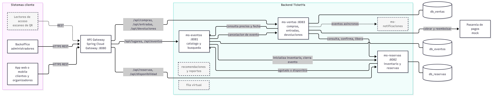

# TicketYa – Arquitectura (Entrega 1)

## 1. Microservicios y responsabilidades

| Servicio | Puerto | Base de datos | Responsabilidad | Req. |
|---|---|---|---|---|
| **api-gateway** | 8080 | – | Punto de entrada único. Enruta `/api/**` a cada servicio y **no expone** `/internal/**` | arquitectura |
| **ms-eventos** | 8081 | `db_eventos` | Catálogo: lugares, sectores, eventos, participantes, precios por sector, estados, búsqueda multicriterio. Dispara la inicialización del inventario al publicar y el cierre al cancelar | 1, 2, 3, 9 |
| **ms-reservas** | 8082 | `db_reservas` | Inventario de lugares (asientos y cupos), reservas temporales de 10 minutos, vencimiento, liberación, límite por cliente y **mecanismo anti doble venta** | 4 (reserva), 5 |
| **ms-ventas** | 8083 | `db_ventas` | Orquesta la compra: valida la reserva, cobra con la pasarela (mock), confirma, emite entradas con QR; idempotencia; devoluciones y reintegros por cancelación de evento | 4, 7 |

Cada servicio es un proyecto Spring Boot independiente (su propio `pom.xml`) que se construye y ejecuta por separado. Cada uno tiene su propia base relacional (schemas separados, levantadas con Docker). La pasarela de pagos es un componente mock dentro de ms-ventas (`PagoGateway` con implementación `MockPagoGateway`).

### API pública por servicio

Resumen de recursos. El detalle completo (parámetros, códigos de respuesta y ejemplos JSON) está en `openapi.yaml`.

| Servicio | Recursos públicos (vía gateway) |
|---|---|
| ms-eventos | `/lugares`, `/lugares/{id}/sectores`, `/eventos`, `/eventos/{id}`, `/eventos/{id}/precios`, `/eventos/{id}/publicar`, `/eventos/{id}/suspender`, `/eventos/{id}/reanudar`, `/eventos/{id}/cancelar`, `/eventos/{id}/sectores` |
| ms-reservas | `/eventos/{id}/disponibilidad`, `/eventos/{id}/sectores/{sid}/asientos`, `/reservas`, `/reservas/{id}` |
| ms-ventas | `/compras`, `/compras/{id}`, `/entradas`, `/entradas/{id}`, `/devoluciones`, `/devoluciones/{id}/aprobar`, `/devoluciones/{id}/rechazar` |

### Rutas del API Gateway

El gateway quita el prefijo `/api` y reenvía cada ruta al servicio correspondiente. Los headers `X-User-Id`, `X-User-Rol` e `Idempotency-Key` se reenvían tal cual.

| Ruta externa | Destino |
|---|---|
| `/api/lugares/**`, `/api/eventos/**` | ms-eventos `:8081` |
| `/api/eventos/*/disponibilidad`, `/api/eventos/*/sectores/*/asientos`, `/api/reservas/**` | ms-reservas `:8082` |
| `/api/compras/**`, `/api/entradas/**`, `/api/devoluciones/**` | ms-ventas `:8083` |
| `/internal/**` | no se enruta (`404`) |

Las rutas de disponibilidad y asientos pertenecen a ms-reservas pero comparten el prefijo `/api/eventos/`. Por eso deben declararse **antes** que `/api/eventos/**` en la configuración del gateway, para que tengan prioridad.

## 2. Diagrama de módulos

Los componentes con línea punteada se implementan en la Entrega 2.



Dependencias síncronas entre servicios (todas REST):

| Origen | Destino | Para qué |
|---|---|---|
| ms-eventos | ms-reservas | Inicializar inventario al publicar; cerrar inventario al suspender o cancelar |
| ms-eventos | ms-ventas | Notificar la cancelación del evento para reintegrar entradas |
| ms-reservas | ms-eventos | Informar que el evento quedó agotado o volvió a tener lugares |
| ms-ventas | ms-reservas | Consultar la reserva, confirmarla, liberarla, devolver lugares |
| ms-ventas | ms-eventos | Obtener precios, estado y fecha del evento al comprar |

Las rutas `/internal/**` solo se invocan entre servicios; el gateway no las expone.

## 3. Mecanismo anti doble venta

La garantía vive en la **base de datos de ms-reservas**, no en memoria, por lo que funciona con varias instancias del servicio ejecutándose a la vez.

**Sectores numerados.** Al publicar el evento se generan las filas de `asiento` (una por lugar) en estado `LIBRE`, con `UNIQUE(evento_id, sector_id, fila, numero)`. Reservar es un `UPDATE` condicional dentro de una transacción:

```sql
UPDATE asiento
   SET estado = 'RESERVADO', reserva_id = :reservaId, version = version + 1
 WHERE evento_id = :e AND sector_id = :s AND estado = 'LIBRE'
   AND (fila, numero) IN (:lugares);
```

Si las filas afectadas son menos que los asientos pedidos, se hace rollback y se responde `409` (todo o nada). Como dos transacciones no pueden actualizar la misma fila a la vez, solo una gana. Además, `@Version` (bloqueo optimista de JPA) actúa como segunda barrera.

**Sectores no numerados.** Se descuenta el cupo de forma atómica:

```sql
UPDATE inventario_sector
   SET disponibles = disponibles - :n
 WHERE evento_id = :e AND sector_id = :s AND disponibles >= :n;
```

Si no afecta ninguna fila, no había cupo (`409`). Se agrega `CHECK (disponibles >= 0)` como red de seguridad.

**Transiciones de reserva mutuamente excluyentes.** Confirmar usa `WHERE estado = 'PENDIENTE' AND expira_en > now()` y vencer usa `WHERE estado = 'PENDIENTE' AND expira_en <= now()`. Una reserva no puede estar confirmada y vencida a la vez.

**Idempotencia del pago.** `compra` tiene `UNIQUE(cliente_id, idempotency_key)` y guarda un hash del request. Un reintento con la misma clave devuelve la respuesta original sin volver a cobrar. `confirmar` y `liberar` son idempotentes.

**Prueba.** Un test lanza N hilos (por ejemplo 50) con un `CountDownLatch` que reservan el mismo asiento, y otro que compite por el último cupo de una zona; verifica exactamente un éxito y N-1 respuestas `409`. Se ejecuta contra una base real (Testcontainers o la de Docker), porque H2 no refleja bien el comportamiento de bloqueos.

## 4. Consistencia en la compra (saga orquestada por ms-ventas)

No existe una transacción que abarque los tres servicios, así que ms-ventas coordina los pasos y deshace los ya hechos si uno falla.

| Paso | Acción | Si falla, compensación |
|---|---|---|
| 1 | Registrar compra `PENDIENTE` (clave de idempotencia) | Ninguna |
| 2 | Verificar la reserva en ms-reservas (vigente, del cliente) | Compra `FALLIDA`, `410` o `403`; no se cobra |
| 3 | Cobrar en la pasarela | Rechazo: liberar reserva y compra `RECHAZADA` (`402`) |
| 4 | Confirmar reserva en ms-reservas | Si venció: reembolsar el pago, compra `FALLIDA` (`410`) |
| 5 | Emitir entradas con QR y compra `APROBADA` | Si falla la base: reintentar con la misma clave; si no se puede, reembolsar y liberar |

El detalle gráfico está en `secuencia-compra.md`.

## 5. Estados


## 6. Decisiones de diseño

1. **Estado `SUSPENDIDO`.** El enunciado lista cinco estados pero pide que el administrador pueda "suspender"; se agrega `SUSPENDIDO` como estado reversible. Equivale a devolver el evento a `BORRADOR` si se prefiere no sumar un estado.
2. **Identidad sin JWT (E1).** El usuario viaja en `X-User-Id` y su rol en `X-User-Rol` (`CLIENTE`, `ORGANIZADOR`, `ADMIN`, `ACCESO`). Cada servicio valida el rol con un filtro simple; en E2 se reemplaza por JWT.
3. **Límite por cliente en ms-reservas.** Se controla ahí porque conoce reservas activas y lugares vendidos por cliente y evento. El valor (`maxPorCliente`, por defecto 4) se define en el evento y se copia al inventario al publicar.
4. **Asientos pre-generados al publicar.** Simplifica la reserva atómica (`UPDATE` condicional) a costa de insertar una fila por asiento al publicar; para un estadio de 50.000 lugares se hace en lotes.
5. **Pasarela mock.** Decide por el token de pago: `tok_ok` aprueba, `tok_rechazado` rechaza, `tok_timeout` simula fallo de la pasarela. Los reintegros también son simulados.
6. **Precios y fecha.** ms-ventas los obtiene de ms-eventos al comprar y los guarda como snapshot en la compra y en la entrada (necesita la fecha para la regla de 72 horas).
7. **Código QR.** `codigoQr` es un UUID aleatorio, único por entrada; la imagen PNG puede generarse con ZXing en la capa de presentación.
8. **Relevancia en la búsqueda.** Versión simplificada: coincidencia de `q` en nombre, descripción y participantes, y luego cercanía de la fecha.

## 7. Stack técnico (E1)

Java 21 y Spring Boot 3 (web, data-jpa, validation), Spring Cloud Gateway, springdoc-openapi, PostgreSQL (o MySQL) en Docker con un schema por servicio, Flyway o `ddl-auto` para el esquema, JUnit 5 y Mockito para pruebas unitarias, Testcontainers para la prueba de concurrencia, Postman para la colección de requests.
