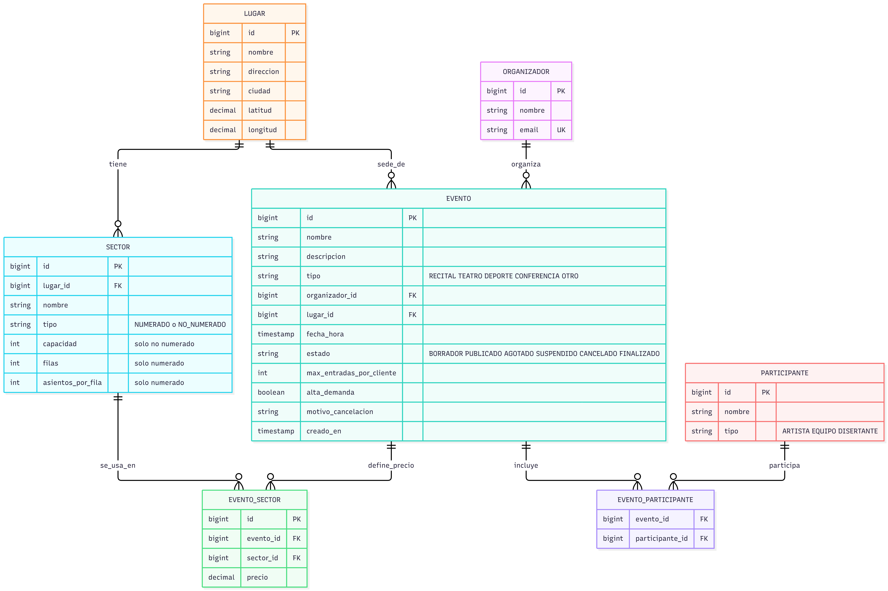
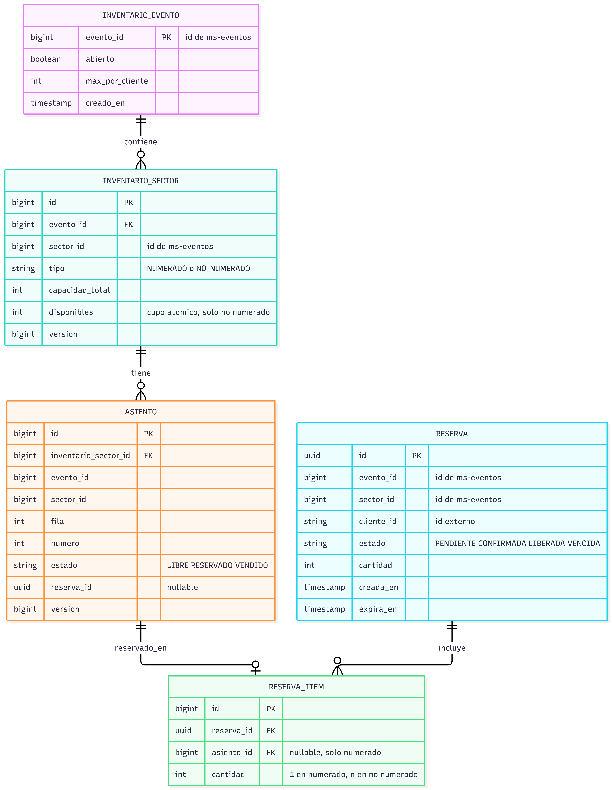
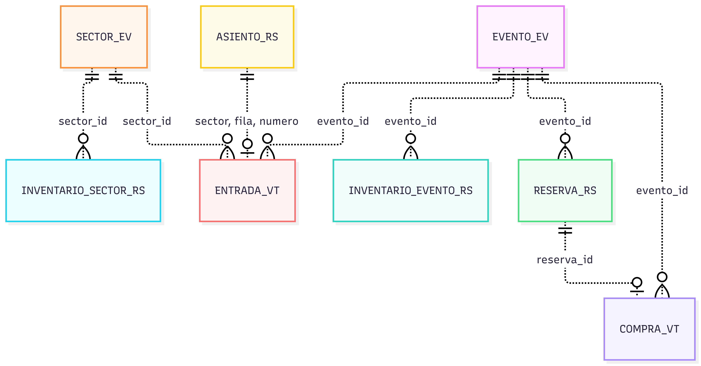

# TicketYa – Modelo de datos (Entrega 1)

Una base relacional por microservicio. Entre servicios **no hay claves foráneas**: las referencias (`evento_id`, `sector_id`, `cliente_id`, `reserva_id`) son lógicas y se validan por REST.
Convención: `PK` clave primaria, `FK` clave foránea dentro del mismo servicio, `UK` clave única. Los ids de catálogo son `bigint` autoincrementales y los de reservas, compras y entradas son `uuid`.

## 1. ms-eventos (`db_eventos`)

Restricciones: `UNIQUE(evento_id, sector_id)` en `evento_sector`; `PK(evento_id, participante_id)` en `evento_participante`; el `sector_id` de `evento_sector` debe pertenecer al `lugar_id` del evento (validado en la lógica de negocio). Índices para la búsqueda: `evento(estado, fecha_hora)`, `evento(tipo)`, `evento(organizador_id)`, `lugar(ciudad)` y `participante(nombre)`.

## 2. ms-reservas (`db_reservas`)

Restricciones clave para la no doble venta:
- `UNIQUE(evento_id, sector_id, fila, numero)` en `asiento`.
- `CHECK (disponibles >= 0)` en `inventario_sector`.
- `UPDATE` condicional por estado (ver `arquitectura.md`, sección 3) y columna `version` para bloqueo optimista.
- Índices: `reserva(estado, expira_en)` para el job de vencimiento, `reserva(cliente_id, evento_id)` para el límite por cliente, `asiento(reserva_id)`.

## 3. ms-ventas (`db_ventas`)

Restricciones: `UNIQUE(cliente_id, idempotency_key)` en `compra`; `UNIQUE(codigo_qr)` en `entrada`; una sola devolución activa por entrada (validado en la lógica); `UNIQUE(entrada_id, tipo)` en `reintegro` cuando `tipo = CANCELACION_EVENTO` para que la cancelación sea idempotente.

## 4. Relaciones entre servicios y entidades solapadas

Las líneas punteadas son referencias lógicas por identificador (sin clave foránea).

(El sufijo indica el servicio: `_EV` ms-eventos, `_RS` ms-reservas, `_VT` ms-ventas.)

| Dato solapado | Dueño (fuente de verdad) | Copia en | Motivo y cómo se sincroniza |
|---|---|---|---|
| `evento_id`, `sector_id` | ms-eventos | ms-reservas, ms-ventas | Referencia por id; se valida por REST al publicar y al comprar |
| Tipo y capacidad del sector | ms-eventos (`sector`) | ms-reservas (`inventario_sector`) | Snapshot al publicar; ms-reservas no depende de ms-eventos para reservar |
| `max_entradas_por_cliente` | ms-eventos (`evento`) | ms-reservas (`inventario_evento.max_por_cliente`) | Snapshot al publicar |
| Estado de abierto o cerrado del evento | ms-eventos (`evento.estado`) | ms-reservas (`inventario_evento.abierto`) | ms-eventos llama a `/internal/eventos/{id}/cerrar` al suspender o cancelar |
| Fecha del evento | ms-eventos | ms-ventas (`entrada.evento_fecha_hora`) | Snapshot al comprar, para la regla de 72 horas sin consultar a ms-eventos |
| Precio del sector | ms-eventos (`evento_sector`) | ms-ventas (`entrada.precio_unitario`) | Snapshot al comprar; el precio histórico no cambia aunque el organizador lo modifique |
| Asiento (sector, fila, número) | ms-reservas (`asiento`) | ms-ventas (`entrada`) | Se copia al emitir la entrada para poder mostrarla sin consultar a ms-reservas |
| `cliente_id` | externo (sin servicio de usuarios en E1) | ms-reservas, ms-ventas | Viene en el header `X-User-Id`; en E2 sale del JWT |
