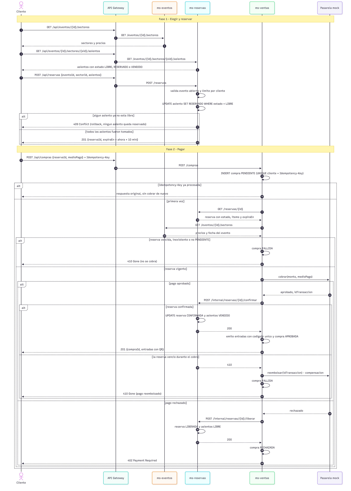
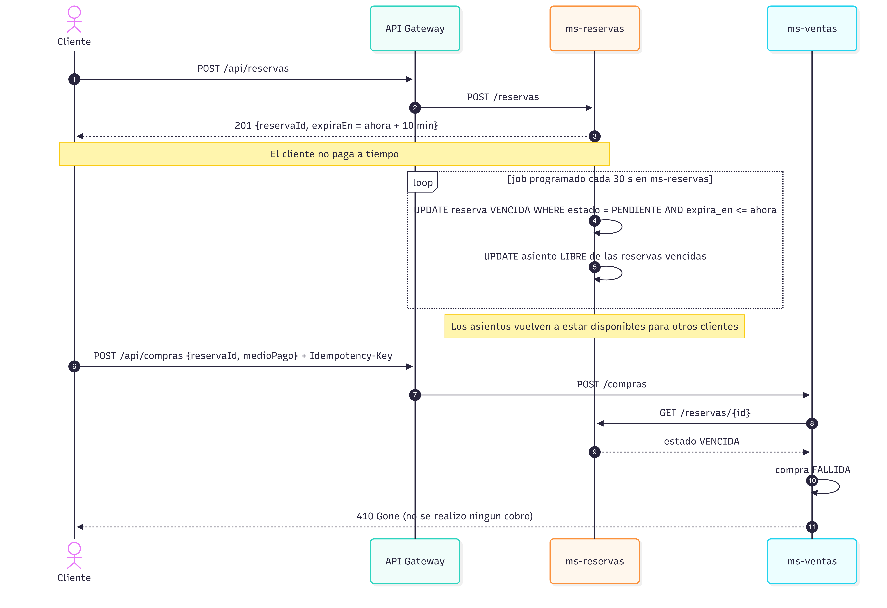
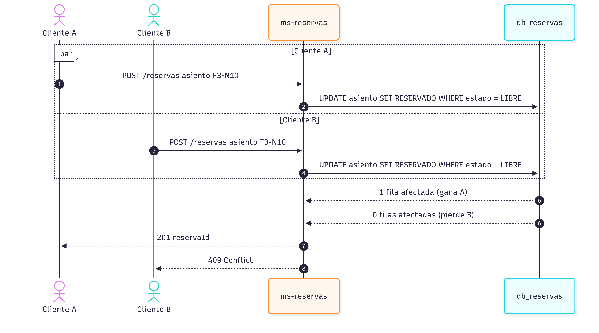

# TicketYa – Diagramas de secuencia de la compra

Compra de una entrada **numerada**. Actores: Cliente, API Gateway, ms-eventos, ms-reservas, ms-ventas y Pasarela de pagos (mock).

## 1. Flujo completo: reserva, pago, aprobación, rechazo y vencimiento durante el cobro

## 2. Reserva que vence antes de pagar

## 3. Dos clientes compiten por el mismo asiento

## Códigos de respuesta del flujo

| Situación | Servicio | Código |
|---|---|---|
| Asiento ya reservado o vendido | ms-reservas | `409` |
| Límite de entradas por cliente superado | ms-reservas | `422` |
| Pago aprobado, entradas emitidas | ms-ventas | `201` |
| Pago rechazado | ms-ventas | `402` |
| Reserva vencida (o venció durante el cobro, con reembolso) | ms-ventas | `410` |
| Reintento con la misma `Idempotency-Key` | ms-ventas | respuesta original |
| Misma clave con otro cuerpo | ms-ventas | `422` |
| Pasarela de pagos no disponible | ms-ventas | `502` o `504` |
